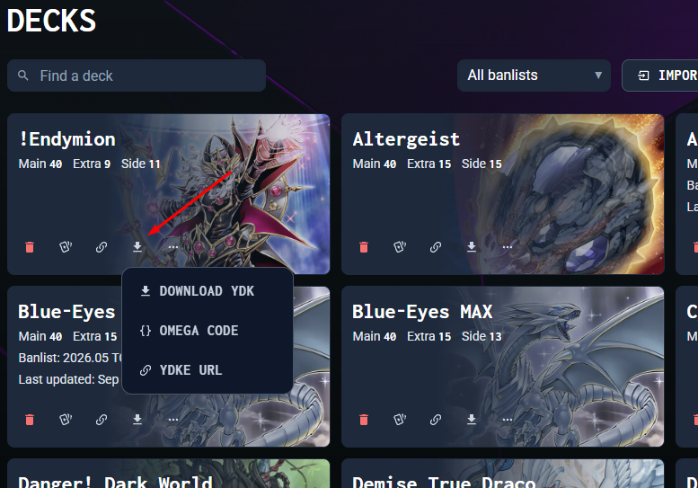
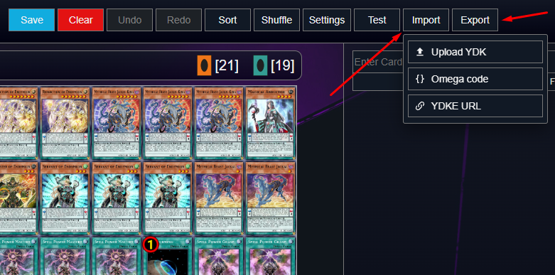

# Dueling Nexus - Deck Import & Export

A Chrome/Edge (Manifest V3) extension that adds deck import and export to [Dueling Nexus](https://duelingnexus.com).

> Unofficial, fan-made project. Not affiliated with or endorsed by Dueling Nexus.

## Features

- **Deck list** (`/decks`): an export button on each deck with three options:
  - **Download YDK** – saves a `.ydk` file
  - **Omega code** – copies an Omega code to the clipboard
  - **YDKE URL** – copies a `ydke://` URL to the clipboard
- **Deck editor** (`/editor/<id>`): **Import** and **Export** buttons in the toolbar.
  - **Export** uses the deck exactly as shown on screen, including unsaved changes.
  - **Import** (Upload YDK / Omega code / YDKE URL) replaces the contents of the deck currently open. It asks for confirmation and can be undone with Undo. Nothing is saved until you click **Save**.

## Screenshots

### Deck list

The export button is placed alongside the site's existing deck actions. Its menu includes Download YDK, Omega code, and YDKE URL.

### Deck editor

The editor toolbar provides separate Import and Export buttons, each with the three supported formats.

## Installation

1. Download or clone this repository.
2. Open `chrome://extensions` (or `edge://extensions`).
3. Enable **Developer mode**.
4. Click **Load unpacked** and select this folder.
5. Reload the Dueling Nexus page.

## Privacy

The extension runs only on `duelingnexus.com`. It reads your decks through the site's own session and sends nothing to any third party.

## Notes

- Omega codes are decoded locally in the browser (raw deflate + base64). Extra Deck cards are identified using the editor's own card database.
- Cards the editor rejects on import (e.g. more than 3 copies, banlist limits) are skipped, and the number of skipped cards is shown.

## License

[MIT](LICENSE)
